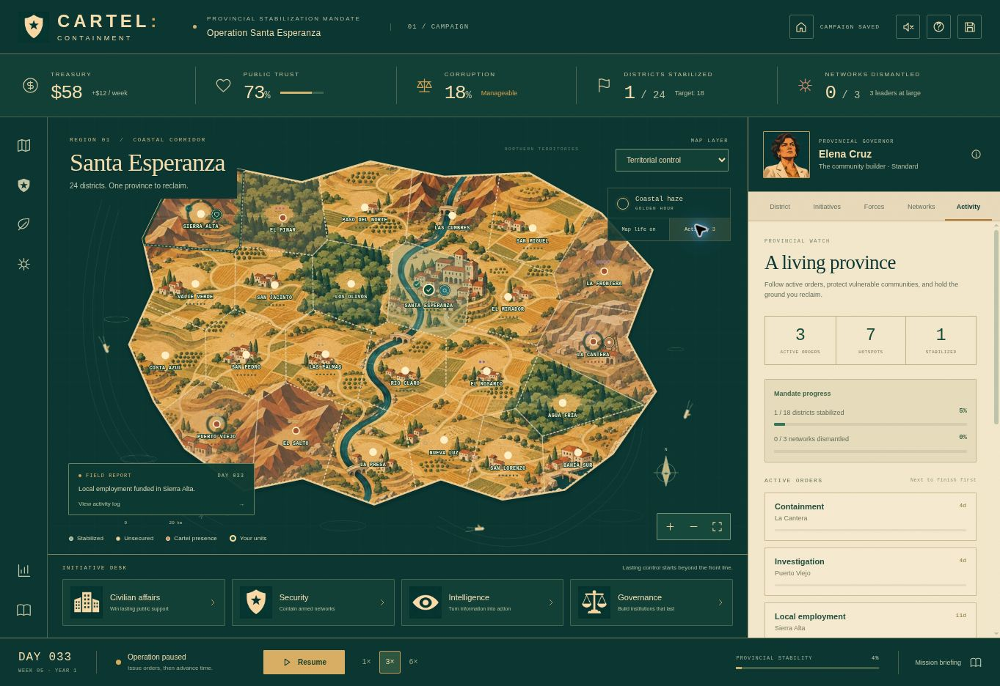

# Cartel: Containment

A playable, original JavaScript province strategy game about restoring civilian control and dismantling three fictional cartel networks. Inspired by the readability and competing priorities of province stabilization games, with its own map, rules, characters, interface and artwork.



Screens: [confrontation animation](docs/confrontation-detail.gif) · [confrontation result](docs/confrontation-result.jpg) · [deployment preview](docs/deployment-preview.jpg) · [main menu](docs/main-menu.jpg) · [loading screen](docs/loading-screen.jpg) · [initiative desk](docs/art-direction-initiatives.jpg)

Artwork: [province painting](assets/santa-esperanza-map.webp) · [district scenes](assets/district-scenes.webp) · [character portraits](assets/portraits-print.webp) · [initiative emblems](assets/initiatives-print.webp)

## Play locally

Requires Node.js 20 or newer. There are **no runtime dependencies, installs, accounts or API keys**.

```sh
npm start
```

Open **http://localhost:8080**. The main menu offers **Continue operation**, **New operation**, save import, the field manual and game information. A new operation lets you choose a governor, difficulty and seed. The illustrated loading screen prepares the artwork before opening command.

In the campaign, select districts on the map, issue orders, then press **Begin** to advance time. Use the book button for your mission briefing and the question mark for the field manual. Escape opens the pause menu; returning to the main menu saves progress and pauses time.

JavaScript modules require a web server. Opening `index.html` directly through `file://` is not supported. Any static web server works, including `python3 -m http.server 8080`.

## The campaign

- A generated, illustrated province painting with 24 precisely interactive districts, eight terrain types, roads, a river, population dots, unit tokens and map layers for control, support and intelligence. Each district also has a terrain-specific scenery panel.
- A main-menu panorama, saved-campaign summary, governor and mandate setup, pause menu and an illustrated loading screen. Loading progress follows actual image loads; failed artwork can be retried or skipped so the campaign remains playable.
- A living province: civilian traffic responds to local threat, fishing boats follow coastal routes, birds and cloud shadows cross the terrain, and changing light brings town lights and occasional passing rain. Native dot and icon assets keep the map readable.
- Smooth unit travel, animated route lines, investigation scans, construction progress rings, delivered-service stamps and map notifications for arrivals, completed work and changes in local control.
- Animated confrontations during containment: cartel dots and security teams exchange bursts, reposition and throw up dust, with actual operation progress and distinct contained, weakened or evaded endings. Encounters pause with campaign time and become static with Map life off.
- An Activity view combines projects, investigations, training and deployment in completion order, with threatened districts, mandate progress and weekly funding dates. During deployment, point to or keyboard-focus a district to see its exact route and ETA.
- Three governors: Elena Cruz (civilian delivery), Rafael Ibarra (security power), and Lucía Vega (evidence and integrity).
- Three fictional cartel networks, each with its own leader, regional cells, funding and case evidence. Networks recruit and can expand into neighboring, unprotected districts.
- Federal units, police and intelligence teams. Movement takes time along connected districts. Recruitment, containment, investigations, asset disruption and leader arrests have real costs and prerequisites.
- Sixteen local initiatives and province-wide policies across civilian affairs, security, intelligence and governance. Spending, inflation, corruption, weekly income and unit upkeep create competing priorities.
- Provincial decisions, public trust, a two-year mandate, victory and defeat, three difficulty levels, and deterministic campaign seeds.
- Local autosave, JSON export/import, keyboard access, optional generated sound cues, reduced-motion support and a responsive layout.

The province painting, menu panorama, district scenery, character portraits and initiative emblems follow the approved art reference: angular cut-paper shapes, ochre highlights, cream silhouettes, deep teal ink and restrained paper grain. They were made with image generation and are included in the repo. Precise district boundaries, selection, status overlays, routes and unit markers remain code-native SVG above the painting. If the painting fails to load, the original terrain map remains available. See [artwork provenance](docs/ARTWORK.md).

## How to win

Stabilize at least **18 of 24 districts**, dismantle **all three networks**, and hold both conditions for **14 consecutive days**.

A district needs at least 60% public support, less than 8% local threat, and either one delivered civilian service or 30% security. Its stability then builds over time; it counts as stabilized at 75% stability.

An arrest needs Special prosecutors, 65% case evidence, 60% intelligence at the leader's base, a ready security unit there, local threat no higher than 30%, and the arrest budget. Arresting a leader stops all further recruitment and expansion for that network. Its remaining cells must still be contained; the network is dismantled when its combined threat falls below one point.

Lose if public trust reaches zero or the two-year mandate expires. All people, districts and organizations are fictional. Operations are abstract game mechanics.

### First moves

1. Investigate Sierra Alta, Puerto Viejo or La Frontera.
2. Open **Forces**, press **Deploy** for ALPHA or BRAVO, and select a destination on the map. Advance time until arrival.
3. Once local intelligence is at least 40%, carry out a containment operation.
4. Fund services in quiet districts, and develop the provincial institutions needed to build cases against the leaders.

Space pauses or resumes during a campaign. Keys 1, 2 and 3 select 1×, 3× and 6× time. H opens the manual. Tab and Enter navigate controls and districts. Escape closes dialogs, cancels deployment or opens the pause menu. Decisions pause time until answered. Time never advances on the main menu or loading screen.

**Map life** toggles ambient motion independently of the mandate. Civilian ambience can move while planning; unit travel and order progress stop when campaign time is paused. Changing light and weather are cosmetic. Reduced motion is respected, and the map preference is saved separately from campaign data. See [living-map behavior](docs/LIVING-MAP.md).

## Develop and verify

```sh
npm run check
npm test
npm run test:balance
npm run build
node tools/serve.mjs --dist
```

`npm test` runs 38 checks covering confrontation triggers and outcomes, animation pause and lifecycle timing, legacy save compatibility, the animation clock, route previews, activity ordering, milestone accuracy, artwork coverage, bounded asset loading, image failures, campaign rules, graph connectivity, resource guards, timed work, arrests, decisions, deterministic saves, malformed imports and terminal states. It also plays complete campaigns through legal orders. The balance driver runs nine reproducible campaigns across difficulty levels without granting resources or directly changing the simulation.

`npm run build` copies the static release into `dist/`. Deploy that directory to any static host, preserving its relative paths. Asset URLs also work when hosted below a subdirectory. The development server supports `PORT=8081 npm start` or `node tools/serve.mjs --port=8081`.

## Project structure

| Path | Purpose |
| --- | --- |
| `src/engine.js` | Deterministic simulation, orders, victory and validated saves; no DOM dependency |
| `src/data.js` | Campaign definitions, policies, fictional characters and decisions |
| `src/geography.js` | Clipped district geometry, adjacency and route finding |
| `src/map.js` | SVG cartography, units, map layers, selection, zoom and panning |
| `src/world.js` | Presentation clock, motion sampling, civilian routes, weather, activity queue and milestones |
| `src/confrontation.js` | Containment encounters, exchange timing and confirmed result effects |
| `src/app.js` | Command interface, dialogs, clock, autosave and keyboard controls |
| `src/assets.js` | Artwork manifest, bounded preloading, real progress and load failure handling |
| `screens.css` | Main menu, loading screen, district scenery and illustrated map overlays |
| `living-map.css` | Ambient life, operational animation, map controls and the Activity view |
| `confrontation.css` | Security and cartel formations, tracers, contact dust and outcome styling |
| `assets/` | Generated image atlases and favicon |
| `tools/` | Static server, production build, syntax checks and legal-order campaign driver |
| `tests/` | Node-based regression and campaign tests |

This is a complete first campaign, not a copy of Rebel Inc. Future expansion can add more province maps, distinct network behaviors, longer policy trees and additional campaign events.
