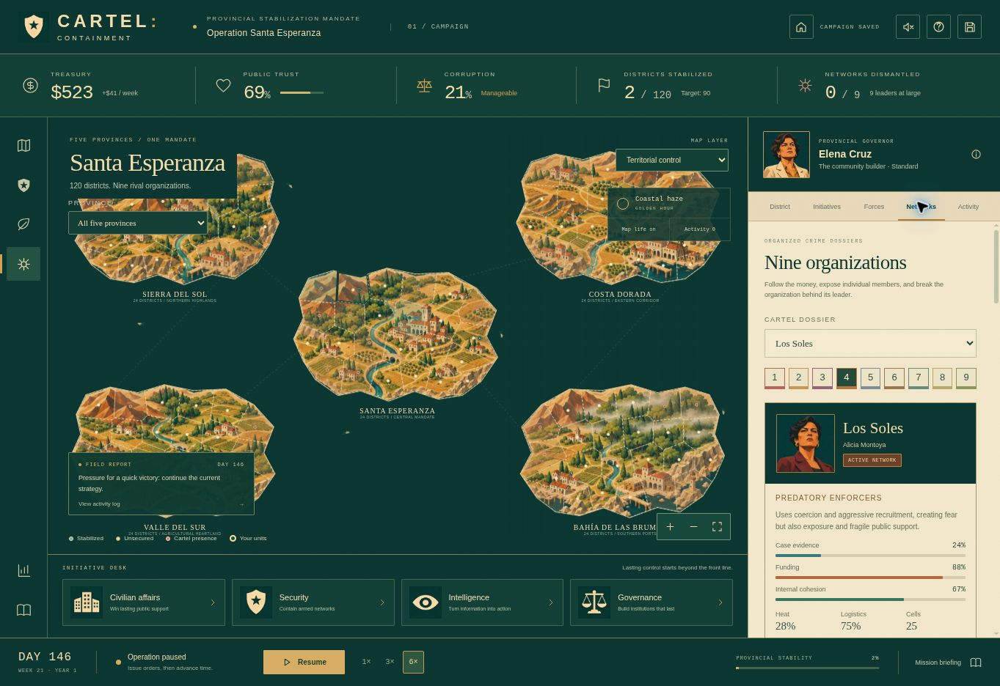

# Cartel: Containment

An original JavaScript strategy game about restoring civilian control across five fictional provinces. The v0.5 campaign expands the playable land and district count by exactly 5×: 120 districts, nine rival cartels, six organizational archetypes and 45 named members.

The cut-paper terrain, portraits, cream symbols and animated dot formations follow the project's established art direction. All people, places and organizations are fictional.



[Regional command and individual member traits](docs/cartel-member-traits.jpg) · [Verification notes](docs/VERIFICATION.md)

## Play

Requires Node.js 20 or newer. No runtime dependencies, accounts or API keys.

```sh
npm start
```

Open http://localhost:8080. Choose **New operation**, a governor, difficulty and seed. Issue orders while paused, then press **Begin**. The main menu, loading screen, autosave, import/export, field manual and pause menu are included. Modules need a web server; opening the HTML directly through `file://` is unsupported.

Use the province selector for detailed regional command or **Fit province** for the country overview. All 120 districts are selectable. Ferry corridors connect the five land masses; deployments follow weighted routes with terrain, transport and road-repair costs.

## The expanded simulation

| Layer | Campaign behavior |
| --- | --- |
| Communities | Support, intelligence, security, stability, prosperity, fear, displacement, institutions and delivered services interact over time. |
| Cartel cells | Multiple rival factions can occupy one district. Operations target a particular faction; total threat is the sum of its cells. |
| Organizations | Funds, cohesion, heat, logistics, evidence, territory, rival relations and temporary pacts shape decisions and recovery. |
| Individual members | Each organization has a leader, lieutenant, financier, recruiter and fixer. Every member has a name, skill, loyalty, exposure, location and two traits. |
| Security forces | Up to 18 units have supply, readiness and fatigue. Distant deployment and operations consume resources; a three-day resupply restores an exhausted unit. |
| Government | Twenty policies and initiatives span local projects, provincial programs and mandate-wide institutions. Inflation, corruption, prosperity, weekly funding and upkeep affect the budget. |

### Cartel archetypes and AI

- **Territorial strongholds** favor difficult terrain, defenses and organizational cohesion.
- **Mercantile networks** value ports, income, transport and arrangements with rivals.
- **Clandestine cells** protect command locations, avoid exposure and relocate under pressure.
- **Predatory enforcers** favor aggression, coercion and recruitment, creating fear and exposure.
- **Patronage machines** exploit weak institutions and poor legitimate livelihoods.
- **Mobile raiders** exploit vulnerable districts and withdraw from concentrated security pressure.

The AI ranks affordable plans using current government presence, terrain, support, prosperity, institutions, resources, exposure, member capabilities and rival activity. It chooses among leading plans through the seeded campaign PRNG. Actions include fortification, recruitment, expansion, bribery, coercion, withdrawal, command relocation, attacks on rivals and temporary pacts. Decisions have real costs and effects. Each dossier records recent decisions and their reasons.

Fourteen member traits alter capabilities, loyalty or succession prospects. Removing a financier lowers income; a recruiter affects recruitment, a lieutenant defensive coordination, and a fixer bribery. Investigate a member's district to raise exposure, then capture them or negotiate a witness deal. Loyalty and witness protection affect deal success.

Arresting a leader opens a succession window. A funded, cohesive organization with enough remaining territory and an active candidate can appoint a named successor. Disrupt its assets and specialist staff to prevent recovery. Succession promotes an existing member, leaving their old role vacant. It does not create an unlimited supply of new leaders.

### Civilian control and logistics

Provincial water and clinic programs deliver one eligible district per day after the program opens. Threatened districts wait until conditions improve; in-flight local deliveries are never duplicated. Regional administration improves institutions, supply and security, and opens a regional recruitment base. Secure police stations can also recruit locally.

Prosperity expands the weekly tax base, while more units increase upkeep. Fear and displacement erode support. Institutions, services and permanent police presence help contain cells after units leave. Supply corridors, regional bases and the logistics policy sustain distant forces; supply, readiness and fatigue modify operational power.

### Objectives

Stabilize **90 of 120 districts**, dismantle **all nine networks**, and hold both conditions for **14 consecutive days**. The mandate lasts 1,095 days. A district counts as stable at 75% stability, at least 60% support and less than 8% total threat. Stability builds with a delivered civilian service or at least 30% security.

Leader arrests require Special prosecutors, 65% case evidence, 60% local intelligence at the current leader location, at least 12 ready security power there, no more than 30% local threat, and the arrest budget. A captured organization is dismantled when its remaining total cell strength falls below three threat points. Public trust reaching zero or the mandate expiring causes defeat.

## Presentation and controls

Animated confrontations show opposing dot formations, alternating bursts and dust, progress and confirmed operation results. Civilian traffic responds to local threat. Boats, birds, clouds, rain and changing light animate the country. Unit travel and work progress follow campaign time; decorative atmosphere does not affect the simulation or consume its randomness.

Space pauses/resumes, 1/2/3 select time speeds, H opens the manual, and Escape closes a dialog, cancels deployment or opens the pause menu. Tab and Enter navigate districts and controls. Map life can be disabled and reduced motion is respected.

Version-one saves migrate automatically: the original 24 districts, units, cases, resources and in-flight work are preserved while the wider campaign is added. Prior victories open the expanded mandate; prior defeats remain campaign reports. Imports are validated, and restored campaigns always pause.

Artwork: [five-province terrain](assets/mandate-map.webp), [new leaders](assets/cartel-leaders.webp), [original portraits](assets/portraits-print.webp), [terrain scenes](assets/district-scenes.webp), [initiative emblems](assets/initiatives-print.webp). See [artwork provenance](docs/ARTWORK.md), [simulation design](docs/SIMULATION.md), [map animation](docs/LIVING-MAP.md) and [confrontation behavior](docs/CONFRONTATIONS.md).

## Verify and build

```sh
npm run check
npm test
npm run test:balance
npm run build
node tools/serve.mjs --dist
```

The 58 tests cover campaign rules, exact map area and connectivity, weighted routing, AI plans and costs, trait effects, pacts, succession, member capture and defection, multi-faction encounters, regional delivery, supply, recruitment, version-one migration, save validation, deterministic replay, loading failures and animation behavior. Five complete campaigns are played through legal orders in the suite. The separate balance driver runs nine campaigns across three seeds and three difficulties without granting resources or directly editing simulation state.

The build copies the static release to `dist/`. Deploy its contents to any static host, preserving relative paths. Subdirectory hosting is supported. Use `PORT=8081 npm start` or `node tools/serve.mjs --port=8081` for another development port.

| Path | Purpose |
| --- | --- |
| `src/simulation.js` | Campaign rules, resources, orders, progression and objectives |
| `src/cartels.js` | Archetypes, members, traits, capabilities and faction cells |
| `src/cartel-ai.js` | Ranked AI plans, decisions, diplomacy and succession |
| `src/saves.js`, `src/legacy-save.js` | Validated version-two saves and version-one migration |
| `src/engine.js` | DOM-independent public simulation API |
| `src/data.js`, `src/geography.js` | Campaign definitions, exact district geometry and routing |
| `src/map.js`, `src/world.js` | Map rendering, presentation clock, animation and activity |
| `src/confrontation.js` | Confrontations and confirmed result effects |
| `src/app.js` | Interface, dialogs, clock, autosave and keyboard controls |
| `strategy.css` | Country overview, regional controls, logistics and dossiers |
| `assets/`, `docs/` | Generated art, provenance and implementation notes |
| `tests/`, `tools/` | Regression tests, legal-order balance driver and build tools |
