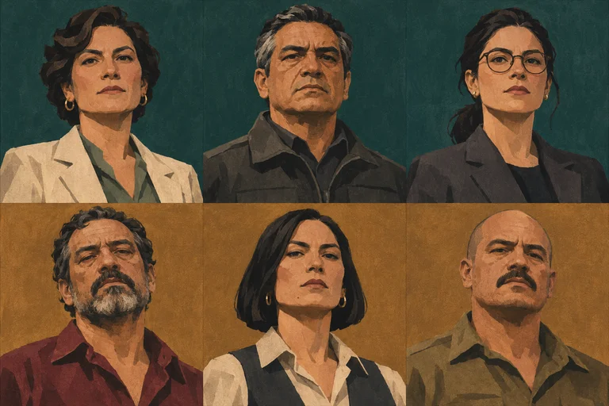

# Cartel: Containment

A playable, original JavaScript province strategy game about restoring civilian control and dismantling three fictional cartel networks. Inspired by the readability and competing priorities of province stabilization games, with its own map, rules, characters, interface and artwork.



## Play locally

Requires Node.js 20 or newer. There are **no runtime dependencies, installs, accounts or API keys**.

```sh
npm start
```

Open **http://localhost:8080**. Select districts on the map, issue orders, then press **Begin** to advance time. Use the book button for your mission briefing and the question mark for the field manual.

JavaScript modules require a web server. Opening `index.html` directly through `file://` is not supported. Any static web server works, including `python3 -m http.server 8080`.

## The campaign

- One illustrated province with 24 connected districts, seven terrain types, roads, a river, population dots, unit tokens and map layers for control, support and intelligence.
- Three governors: Elena Cruz (civilian delivery), Rafael Ibarra (security power), and Lucía Vega (evidence and integrity).
- Three fictional cartel networks, each with its own leader, regional cells, funding and case evidence. Networks recruit and can expand into neighboring, unprotected districts.
- Federal units, police and intelligence teams. Movement takes time along connected districts. Recruitment, containment, investigations, asset disruption and leader arrests have real costs and prerequisites.
- Sixteen local initiatives and province-wide policies across civilian affairs, security, intelligence and governance. Spending, inflation, corruption, weekly income and unit upkeep create competing priorities.
- Provincial decisions, public trust, a two-year mandate, victory and defeat, three difficulty levels, and deterministic campaign seeds.
- Local autosave, JSON export/import, keyboard access, optional generated sound cues, reduced-motion support and a responsive layout.

The character portrait atlas and initiative badge atlas were made with image generation and are included in the repo. The map, units and navigation symbols are code-native SVG for precise scaling and readable state changes. See [artwork provenance](docs/ARTWORK.md).

## How to win

Stabilize at least **18 of 24 districts**, dismantle **all three networks**, and hold both conditions for **14 consecutive days**.

A district needs at least 60% public support, less than 8% local threat, and either one delivered civilian service or 30% security. Its stability then builds over time; it counts as stabilized at 75% stability.

An arrest needs Special prosecutors, 65% case evidence, 60% intelligence at the leader's base, a ready security unit there, local threat no higher than 30%, and the arrest budget. Arresting a leader stops all further recruitment and expansion for that network. Its remaining cells must still be contained; the network is dismantled when its combined threat falls below one point.

Lose if public trust reaches zero or the two-year mandate expires. All people, districts and organizations are fictional. Operations are abstract game mechanics.

### First moves

1. Investigate Sierra Alta, Puerto Viejo or La Frontera.
2. Open **Forces**, press **Deploy** for ALPHA or BRAVO, and select a destination on the map. Advance time until arrival.
3. Once local intelligence is at least 40%, carry out a containment operation.
4. Fund services in quiet districts, and develop the provincial institutions needed to build cases against the leaders.

Space pauses or resumes. Keys 1, 2 and 3 select 1×, 3× and 6× time. H opens the manual. Tab and Enter navigate controls and districts; Escape closes dialogs or cancels deployment. Decisions pause time until answered.

## Develop and verify

```sh
npm run check
npm test
npm run test:balance
npm run build
node tools/serve.mjs --dist
```

`npm test` covers campaign rules, graph connectivity, resource guards, timed work, arrests, event decisions, deterministic saves, malformed imports and terminal states. It also plays complete campaigns through legal orders. The balance driver runs nine reproducible campaigns across difficulty levels without granting resources or directly changing the simulation.

`npm run build` copies the static release into `dist/`. Deploy that directory to any static host, preserving its relative paths. Asset URLs also work when hosted below a subdirectory. The development server supports `PORT=8081 npm start` or `node tools/serve.mjs --port=8081`.

## Project structure

| Path | Purpose |
| --- | --- |
| `src/engine.js` | Deterministic simulation, orders, victory and validated saves; no DOM dependency |
| `src/data.js` | Campaign definitions, policies, fictional characters and decisions |
| `src/geography.js` | Clipped district geometry, adjacency and route finding |
| `src/map.js` | SVG cartography, units, map layers, selection, zoom and panning |
| `src/app.js` | Command interface, dialogs, clock, autosave and keyboard controls |
| `assets/` | Generated image atlases and favicon |
| `tools/` | Static server, production build, syntax checks and legal-order campaign driver |
| `tests/` | Node-based regression and campaign tests |

This is a complete first campaign, not a copy of Rebel Inc. Future expansion can add more province maps, distinct network behaviors, longer policy trees and additional campaign events.
