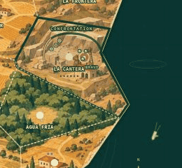

# Current confrontation phases, v0.6

Operation progress now drives three presentation phases: advancing below 18%, contact from 18% to 72%, and containment for the remainder. Security dots approach before exchanges begin, then shift to a surrounding formation. Tracers alternate; impacts follow travel. Smoke and cover remain decorative. The phase and progress ring interpolate with the authoritative campaign fraction. Pause freezes encounter time, hidden views remove transient results, and reduced motion leaves a static encounter marker. Confirmed contained, weakened and evaded reports still determine endings.

The earlier implementation and evidence record follows.

# Confrontation animation, v0.5

Native captures: [full province](confrontation-map.jpg) · [confirmed result](confrontation-result.jpg) · [motion off](confrontation-motion-off.jpg) · [motion on](confrontation-motion-on.jpg). The comparison captures use the same containment order and normal province camera. The GIF crops the encounter area from 24 browser frames recorded over 1.85 seconds, with their original sampling intervals; it is a recorded detail, not a generated illustration.

Containment orders now show a small encounter at the actual district and assigned security unit. Warm cream security markers face network-colored cartel dots. Alternating short trails, muzzle glows, contact dust and shifting formations make the confrontation readable at the normal province camera. A perimeter arc displays the order's actual progress. The unit remains selectable beneath the non-interactive effect layer.

The active exchange is an illustration of the ongoing operation. The game resolves that operation once, using its existing chance, intelligence and power calculation. No individual shot adds damage, consumes randomness or changes the forecast.

## Effect contract

| Effect | Trigger and attachment | End and cleanup |
| --- | --- | --- |
| Confrontation formation | Accepted `raid` order, present operating federal/police unit, and positive local threat; district space with the security side anchored to the actual unit marker | Order disappears, unit no longer matches, local cell disappears, or campaign object changes |
| Exchanges and dust | Two alternating releases in a 1.8-second loop; trail travels for 0.3 seconds before contact dust | Each contact fades after 0.32 seconds; no queued timers or released particles survive an interrupted encounter |
| Progress perimeter | Actual order duration and remaining days | Removed with the encounter |
| Contained/weakening ending | Engine success report tagged `cleared` or `suppressed` | Ring and dots fade over 3.2 seconds of running presentation time |
| Evasion ending | Engine failure report tagged `evaded` | Dots retreat; ochre result label and ring fade on the same bounded lifetime |

Results come from optional structured `encounter` metadata on the existing field-log entry. They distinguish successful weakening from evasion even though both can reduce threat. Metadata is validated on import; old version-1 saves without it still load. Already-saved results establish a baseline and are not replayed when a campaign opens.

One persistent group belongs to each active encounter. Repeated UI renders update it rather than stacking effects. At most 18 active security units can own encounters, and the result pool is capped at 18 groups with one latest result per district. New campaigns clear both pools. Hidden views remove transient result groups and stop presentation updates. Motion-off removes result effects and retains static faction markers and order progress. Reduced-motion settings use the same static path.

All confrontation motion freezes when campaign time is paused. Visibility and motion checks gate its separate presentation timeline, so the province's moving boats and clouds cannot advance a paused firefight. Existing SVG markers preserve keyboard input and pointer hit testing.

## Verification

Automated coverage checks valid raid ownership, exclusion of intelligence/disruption work, release-before-contact timing, pause/visibility/motion gates, the three engine outcomes, backward-compatible saves, malformed metadata rejection, and unchanged campaign resources and randomness. The v0.5 expansion retains these timing and resource-isolation tests while adding explicit rival-faction targeting. Encounter markers use the order’s target faction and disappear if that particular cell disappears, even when a rival remains in the district. See [current verification](VERIFICATION.md).

These are original code-drawn SVG effects layered over the approved generated province artwork. No new external assets, providers or runtime dependencies are needed.

The v0.4 live review verified a BRAVO/La Frontera confrontation at La Cantera, alternating trails, an interruption by a provincial decision, frozen actor positions and trails while paused, and a cleared-cell ending that agreed with the field report. The active group disappeared on resolution; result groups were absent after playback continued. Returning through the main menu did not replay old results. A single active encounter used 49 descendant SVG nodes, including unused member slots; this is a DOM allocation count, not a hardware frame-time measurement.
